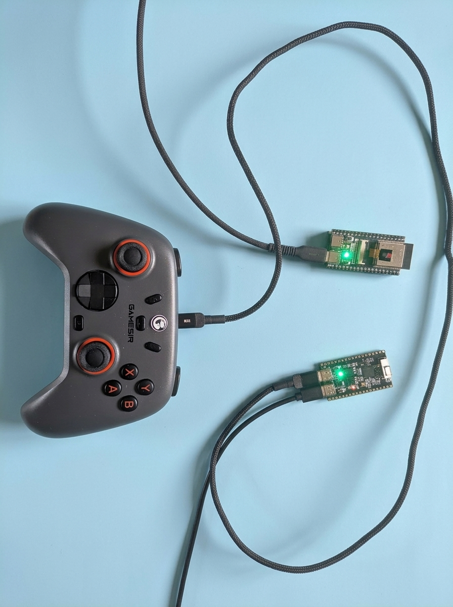

# ESP-NOW_DS4

ESP-NOW is a connectionless low latency WiFi communication protocol defined by Espressif with a longer range than standard WiFi, only needing the MAC Address of another ESP to connect to it. It is only available on ESP devices. It can run concurrently with standard Wifi.  
This app enables a game controller in DS4 mode to be connected to the ESP USB OTG port. The controller inputs can then be sent over ESP-NOW to another ESP hosting eg a drone flight controller.  
The app can be compiled either as a standalone **DS4 Sender** or as a **Receiver example**

## Requirements

The **DS4 Sender** host must support USB OTG so needs to be an ESP32-S2 or ESP32-S3. The board must also supply 5V on the OTG USB Vbus or the connected controller will not be recognised.  
The game controller must have an option to operate in DS4 mode which is standard on generic game controllers.  

## Installation

Download github files into the Arduino IDE sketch folder, removing `-main` from the application folder name.  
In the Arduino IDE instal library [EspUsbHost](https://github.com/tanakamasayuki/EspUsbHost)

Compile using latest arduino-esp32 core with Tools option:
* USB Mode: "USB OTG (TinyUSB)"

In file `appGlobals.cpp` setup the required configuration:
* `#define ESPNOW_SENDER` - leave as is to compile as **DS4 Sender** or comment out to compile as **Receiver example**
* `#define USE_SECURE` - true for encrypted traffic, false for plaintext
* `#define ESPNOW_PSK_BYTES` - if using security create your private key as per instructions in file
* `#define LAMP_PIN` - pin number for onboard LED
* `#define LAMP_TYPE` - 0 for mono LED, 1 for WS2812 / SK6812 RGB led

**DS4 Sender** and **Receiver example** must be compiled with the same `appGlobals.cpp` file content.

The **DS4 Sender** can now operate without further customisation.  

The **Receiver example** will output the buttton name and values of any input received from the Sender.
Modify the `appControllerCommand()` function in `appGlobals.cpp` to interact with your own code, eg by creating a `switch` statement for each button to call a function to handle that button input. See file `usbDS4.cpp` for more information.

## Operation

**DS4 Sender:**
* Connect the game controller to the Sender USB OTG socket.
* Connect power to the Sender USB UART socket. If connected to a PC the Arduino IDE can use its Serial Monitor.
* The Sender now broadcasts on each WiFi channel in turn and if it receives a valid response will start a peer to peer connection to the Receiver MAC address on that channel.
* Start controller in DS4 mode and wait for steady Home button light.
* Inputs made on the game controller are now sent to the Receiver once both Sender and Receiver [LED Status](#led-status) output is steady.
* Heartbeats will monitor if connection is active. Re-connection is automatic unless the Receiver has power cycled and changed channel (see `espNow.cpp`).
* If a re-connection cannot be made, reset the Sender to redo a broadcast.

**Receiver example:**
* Power up the Receiver device.
* After connection established, the Receiver example can output details of any input to the Arduino Serial Monitor.

## LED Status

The onboard LED of each device can be used to indicate the ESP-NOW connection status. Value in brackets is WS2812 LED color if available:
* Starting up: Medium blink (Cyan)
* Connected: Steady (Green)
* Failed to startup: Rapid blink (Red)
* Not connected: Slow blink (Magenta)

